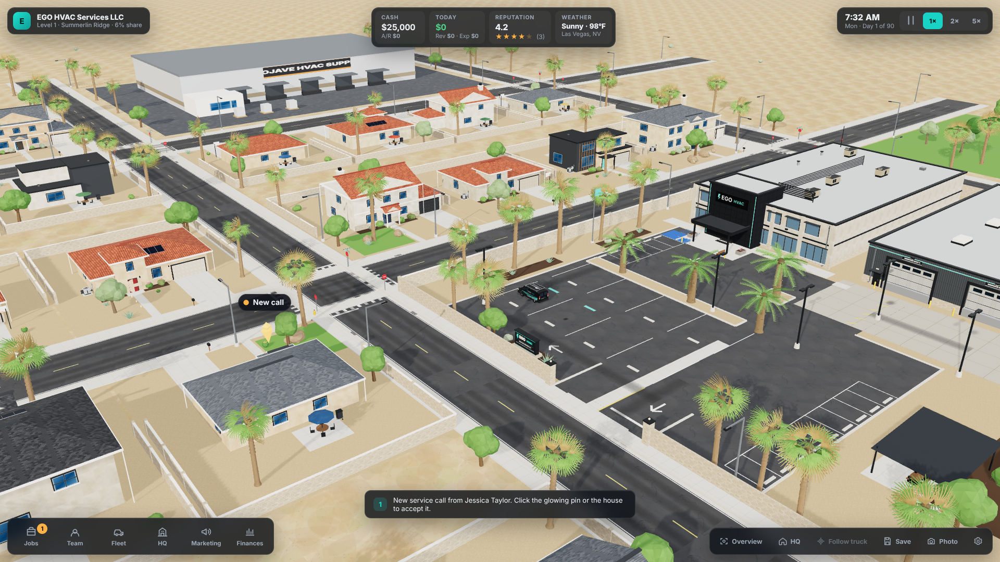

# HVAC Company Owner V3: EGO HVAC Empire

A browser-based **3D HVAC business tycoon game**. You own EGO HVAC Services LLC, a small
diagnostics-first heating and air company in a stylized, sunlit Las Vegas neighborhood.
Accept service calls, dispatch branded vans along real roads, measure instead of guess,
quote repairs and replacements, collect payment, hire and train a team, grow the fleet and
expand the headquarters over **The First 90 Days**.

> Most HVAC companies guess. We measure. — *Measured. Verified. Done Right.*



## Premium graphics (v3-premium-graphics)

The visual overhaul replaced the prototype art with glTF service vehicles, five merged PBR house
archetypes, instanced desert vegetation, a rebuilt headquarters campus, articulated workers,
a clock-driven sky and sun, daily weather with monsoon rain, and four quality presets. Before and
after evidence lives in `docs/graphics/` with `GRAPHICS_OVERHAUL_REPORT.md`.

Regenerate the vehicle models: `node tools/assets/build.mjs` (writes `public/models/`).

## Visual excellence (v3-visual-excellence)

The second art pass rebuilt the headquarters campus and parking lot, the four vehicle bodies,
palms, house detail, condensers and job-site tools, the worker rig, the lighting day cycle with
night light pools, and added a Photo Mode. Before and after captures at three viewports and the
per-comparison write-up live in `docs/visual-excellence/` (`BEFORE_AUDIT.md`,
`VISUAL_QUALITY_REPORT.md`).

| Preset | Shadows | Pixel ratio | Vegetation | Rain |
| --- | --- | --- | --- | --- |
| Low | off | 1× | sparse desert | off |
| Medium | 2k map | up to 1.25× | reduced desert | 900 streaks |
| High | 4k map | up to 1.5× | full | 1,800 streaks |
| Ultra | 4k map, tighter frustum | up to 2× | dense desert | 3,000 streaks |

## Stack

TypeScript · Three.js · React Three Fiber · Drei · React 19 · Vite 8 · Zustand · Vitest · Playwright.
All 3D art is original: procedural geometry in the browser plus glTF vehicles generated by `tools/assets` (no third-party assets; see `ASSET_LICENSES.md` and `docs/graphics/ASSET_MANIFEST.md`).

## Install and run

Requirements: Node.js 20 or newer (tested on 22). Any modern desktop browser with WebGL 2.

```powershell
# Windows PowerShell
git clone <this repository> HVAC-Company-Owner-V3-ThreeJS
cd HVAC-Company-Owner-V3-ThreeJS
npm install
npm run dev          # development server at http://127.0.0.1:5173
```

Production build and preview:

```powershell
npm run build        # type-check + production bundle in dist/
npm run preview      # serves dist/ at http://127.0.0.1:4173
```

Quality gates:

```powershell
npm run typecheck    # TypeScript (app + tooling)
npm run lint         # ESLint
npm test             # Vitest simulation suite (determinism, routing, accounting, 90-day campaign)
npm run test:e2e     # Playwright real-browser gameplay test (builds must exist: run npm run build first)
npm run check        # typecheck + lint + unit tests + build
```

The Playwright config launches `/opt/pw-browsers/chromium` with SwiftShader flags for the
cloud CI container. On a Windows PC remove `launchOptions` from `playwright.config.ts`
(or run `npx playwright install chromium`) to use the installed Chromium with a real GPU.

## Controls

| Action | Input |
| --- | --- |
| Pan | Left-drag, `W A S D`, arrow keys |
| Orbit | Right-drag, `Q` / `E` |
| Zoom | Mouse wheel (5 m to 340 m) |
| Select | Left-click a house, truck, worker, HQ, warehouse or competitor |
| Pause / speed | `Space`, `1`, `2`, `3` (= 5×) or the HUD buttons |
| Jump to HQ | `H` |
| Follow the active truck | `F` |
| Reset camera | `Home` |
| Jobs / Team / Fleet panels | `J` / `T` / `V` |
| Close panel or deselect | `Esc` |
| Photo Mode (HUD off, free camera, time and weather preview, PNG save) | `P` or the Photo button |

## How a service call plays

1. A customer calls. A glowing pin appears over their house and a toast arrives.
2. Click the pin or house, read the complaint and equipment data, **Accept**.
3. Choose a technician and a vehicle, **Dispatch**. The van leaves HQ, drives the road network (A*), and parks at the curb. ETA is derived from route length and vehicle speed, and respects pause and 1×/2×/5×.
4. The technician walks to the condenser and takes measurements. Readings depend on their diagnostic accuracy and fatigue; a misread can point at the wrong part.
5. Review the findings, pick a diagnosis from the plausible candidates, then present a **repair** (adjustable price, visible margin) or a **replacement** (equipment tier, financing).
6. Direct customers pay on completion. Home-warranty customers require authorization and pay net 35 days into receivables.
7. The van returns to HQ. Reviews, trust, XP, fatigue and milestones update. Wrong diagnoses come back as callbacks.

## Current features

- Interactive 3D Summerlin Ridge neighborhood: 32 houses in five styles, three streets and three avenues, desert landscaping, HQ, supply warehouse, competitor building, park, distant mountains, warm Las Vegas lighting and shadows.
- Tycoon camera: pan, orbit, zoom, focus flights, HQ shortcut, follow-truck, keyboard controls, clamped bounds.
- Clickable houses, HQ, trucks, workers and commercial buildings with a contextual inspector. Decorative objects are never clickable.
- Four procedural branded vehicle classes (compact van, full-size van, pickup, box truck) with wrap, decals, ladder rack, shelving, tool storage, cargo and liftgate upgrades, paint, new/used purchase, cash/loan/lease financing, resale.
- Four employee roles with a 13-attribute system, XP/levels, morale, fatigue, nine training programs with certifications, hiring market, raises and dismissal. Workers are visible characters that walk, kneel and work at the unit.
- Twelve credible residential HVAC faults with evidence-based diagnosis, look-alike faults, repair pricing, replacement tiers (R-454B), warranty authorization, callbacks and reviews.
- Deterministic simulation with a ledger-based economy: payroll, fuel, upkeep, parts, marketing, loans, leases, receivables, reconciliation checks, daily history.
- Marketing channels, brand recognition, three competitors and market share.
- Eight HQ upgrades that add real geometry to the headquarters.
- The First 90 Days campaign with 15 milestones, celebrations, tutorial hints, autosave, manual save/load with schema versioning, graphics settings, and a campaign summary.

See `GAME_DESIGN.md`, `ARCHITECTURE.md`, `DEVELOPMENT_ROADMAP.md` and `QA_REPORT.md` for details and an honest status.
